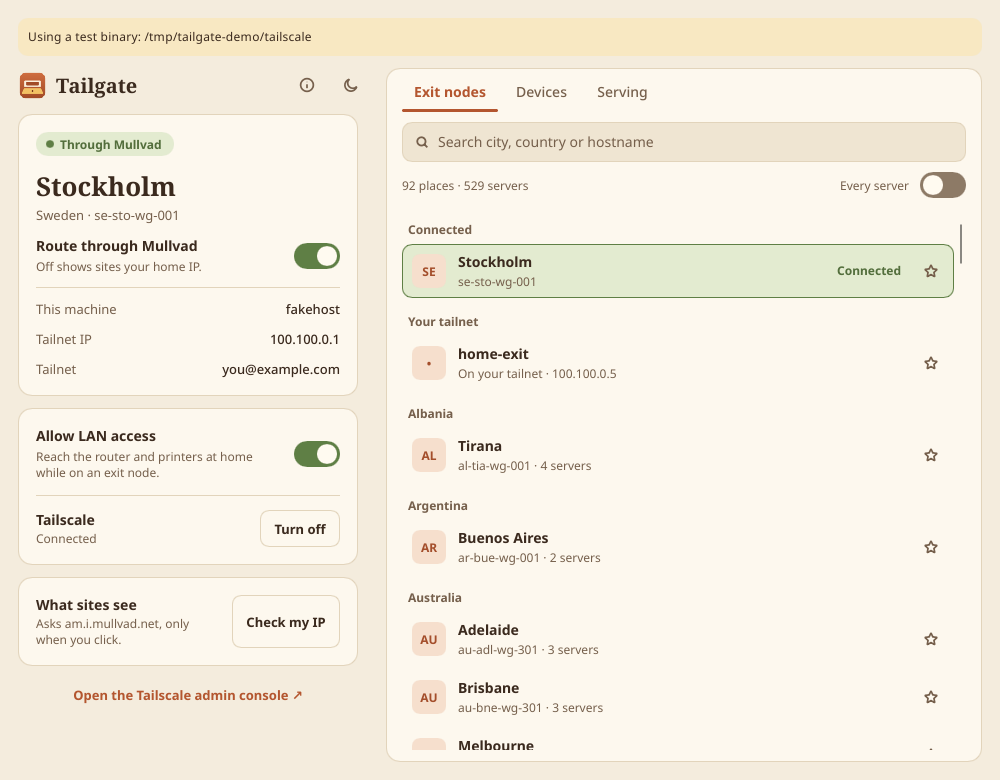
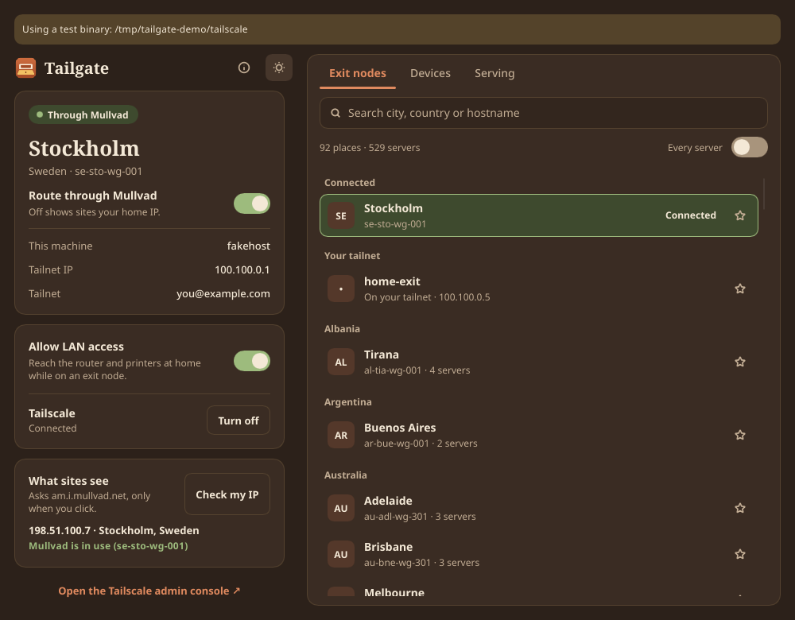
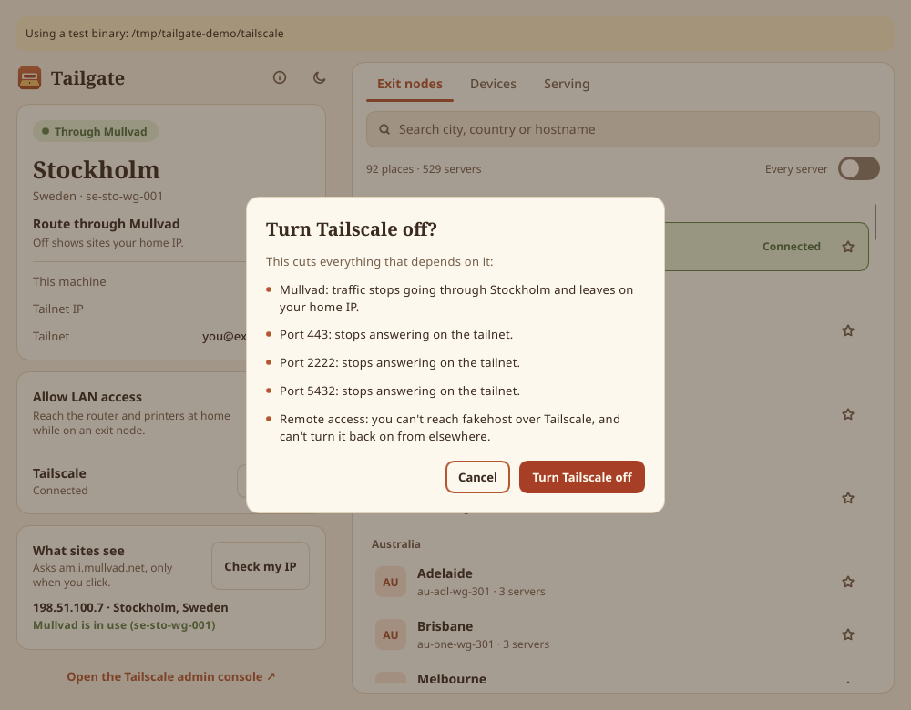
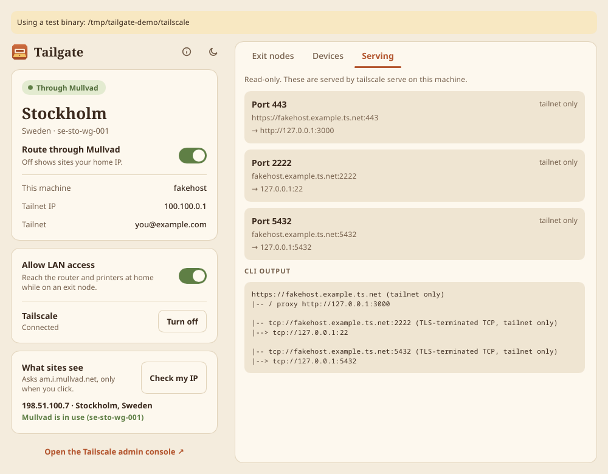
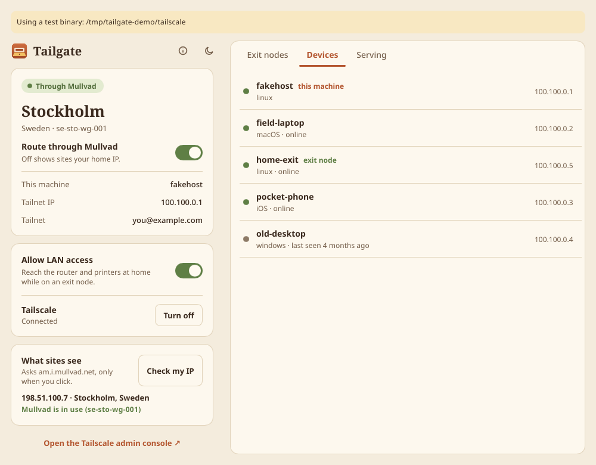

# Tailgate

A native desktop app for [Tailscale](https://tailscale.com) and its Mullvad exit nodes, for Linux, Windows and macOS: see where your traffic is going, pick an exit node from a searchable list, and turn things on and off without the command line.

Free and open source. Written in Rust with [Slint](https://slint.dev). It wraps the `tailscale` CLI you already have.

> **Early release (0.2.2).** On Linux, status, devices and serving have been read from a real daemon, and switching exit nodes, the Mullvad on/off switch and the operator grant have worked on one. Windows and macOS builds are new in 0.2 and less tried: see [Known limitations](#known-limitations). `tailgate --read-only` is a safe way to look around first.

## Download

| | Download | |
|---|---|---|
| **Windows** 10 / 11, 64-bit | `tailgate-0.2.2-windows-x86_64.zip` | Unzip anywhere and open `Tailgate.exe`. Portable, nothing to install. |
| **macOS** 11+, Apple Silicon and Intel | `tailgate-0.2.2-macos-universal.dmg` | Drag Tailgate into Applications. |
| **Ubuntu, Zorin OS, Linux Mint, Pop!_OS** (22.04 base or newer), x86_64 | `tailgate_0.2.2_amd64.deb` | Double-click it and choose Install (below). |
| **Other Linux** x86_64, glibc 2.35+ | `tailgate-0.2.2-x86_64-linux.tar.gz` | Unpack and run `./install.sh` (below). |

All from the [latest release](https://github.com/nunyabiz765/tailgate/releases/latest), each with a `.sha256` beside it. The macOS build is signed and notarized by Apple. The Windows build isn't code-signed yet, so its first launch needs one extra click; the `READ ME FIRST.txt` inside the download walks through it.



| | |
|---|---|
|  |  |
|  |  |

The screenshots use the bundled fake CLI and made-up data, which is why the banner at the top names a test binary. You won't see that banner in normal use.

## What it does

- **Status:** up or down, machine name, tailnet IP, and the current exit node with city and country. Polls `tailscale status --json` and `debug prefs` every 4 seconds on a worker thread, so a slow CLI can't freeze the window.
- **Exit nodes:** one row per city by default, highest priority first, or every server with a toggle. Search by city, country or hostname, accents optional. One click to switch. Favorites, plus a section for non-Mullvad exit nodes on your tailnet.
- **Mullvad off and on:** off warns that sites will see your own IP, then runs `tailscale set --exit-node=`. On restores the last-used node.
- **Allow LAN access:** `tailscale set --exit-node-allow-lan-access=true|false`.
- **Tailscale up and down:** down asks first, and lists what it would cut from the live `tailscale serve status`.
- **Devices** and a read-only **Serving** view.
- **Shares** (new in 0.3): finds SMB file shares on your tailnet's devices and connects them with one click, the way your OS normally does. Each share can connect at login, and comes back after sleep or when Tailscale reconnects. See [File shares](#file-shares).
- **Check my IP:** asks `https://am.i.mullvad.net/json` through curl, only when you click it. That's the only network request Tailgate makes itself.
- **Light and dark** themes, and a layout that adapts to narrow windows.

## Requirements

- Tailscale installed and signed in. Mullvad's add-on on your tailnet, for Mullvad exit nodes; other exit nodes work without it
- **Linux:** x86_64 with Wayland or X11 for the prebuilt binary; the `tailscale` command on your `PATH`; `pkexec` (polkit) for the permission prompt, `curl` for Check my IP, `xdg-open` for links; fontconfig and freetype, which most desktops already have
- **Windows:** 10 or 11, 64-bit, with [Tailscale for Windows](https://tailscale.com/download/windows). Tailgate finds `C:\Program Files\Tailscale\tailscale.exe` (or `tailscale.exe` on `PATH`). `curl` ships with Windows
- **macOS:** 11 or newer, with [Tailscale for Mac](https://tailscale.com/download/mac). See [Which Tailscale on a Mac](#which-tailscale-on-a-mac)

If Tailgate can't find Tailscale on Windows or macOS, the window says so and offers a **Get Tailscale** button. `tailgate --where` prints which `tailscale` it would use.

### Which Tailscale on a Mac

Tailscale for Mac comes in three variants, and Tailgate tells them apart:

- **Standalone** (from tailscale.com): its command line is inside `/Applications/Tailscale.app`, or at `/usr/local/bin/tailscale` once you install the CLI integration from its Settings. Works fully.
- **Mac App Store**: also has the command line inside the app, but the app is sandboxed and its CLI only answers while the Tailscale app is running. Tailgate shows a note saying so, and if Tailscale refuses a change it suggests the Standalone version.
- **Open source `tailscaled`** (Homebrew's `tailscale`, at `/opt/homebrew/bin` or `/usr/local/bin`): works like Linux.

Apps opened from Finder don't get your shell's `PATH`, so Tailgate also looks in `/usr/local/bin`, `/opt/homebrew/bin`, `/Applications` and `~/Applications` by name. It sets `TAILSCALE_BE_CLI=1`, Tailscale's documented switch, so the app binary answers as a CLI instead of opening a second Tailscale window.

## Install on Linux

### Ubuntu, Zorin OS, Linux Mint, Pop!_OS

1. Download `tailgate_0.2.2_amd64.deb` from the [latest release](https://github.com/nunyabiz765/tailgate/releases/latest).
2. Double-click it. It opens in your Software app (Software Manager on Mint, Eddy on Pop!_OS); click **Install** and type your password. Or in a terminal: `sudo apt install ./tailgate_0.2.2_amd64.deb`
3. Open **Tailgate** from the app menu.

Built for Ubuntu 22.04 and 24.04 and the distros based on them, and Debian 12. Each release installs it with apt on clean Ubuntu 22.04 and 24.04 before publishing; Zorin, Mint and Pop!_OS themselves haven't been tried yet. It doesn't install Tailscale, which isn't in the Ubuntu archive. If Tailscale is missing or not signed in, Tailgate opens on a short setup page with the commands and Copy buttons: Tailscale's official installer (`curl -fsSL https://tailscale.com/install.sh | sh`), signing in, and the one-time operator grant. Uninstall with `sudo apt remove tailgate`.

### Any other distro

Download the tarball from the [latest release](https://github.com/nunyabiz765/tailgate/releases/latest), check it, and run the installer:

```sh
sha256sum -c tailgate-0.2.0-x86_64-linux.tar.gz.sha256
tar xf tailgate-0.2.0-x86_64-linux.tar.gz
cd tailgate-0.2.0-x86_64-linux
./install.sh
tailgate --read-only
```

Or build from source, which needs a current Rust toolchain plus the fontconfig and freetype development packages:

```sh
git clone https://github.com/nunyabiz765/tailgate
cd tailgate
./install.sh
```

The installer puts the binary in `~/.local/bin/tailgate`, with a desktop entry and icons under `~/.local/share`. It touches nothing outside your home directory.

To uninstall:

```sh
rm ~/.local/bin/tailgate ~/.local/share/applications/tailgate.desktop
rm ~/.local/share/icons/hicolor/*/apps/tailgate.*
rm -r ~/.config/tailgate
```

## File shares

The **Shares** tab looks for file shares (SMB, what Finder, File Explorer and Files use) on the devices in your tailnet:

1. It asks each online device whether it takes connections on the file-sharing port (TCP 445). Nothing else is sent to a device that doesn't answer.
2. On the ones that do, it tries to list the share names without asking for anything: `smbclient -L` and `gio list` on Linux, `smbutil view -N` on macOS, `net view` on Windows. Many servers only list shares after you sign in; those show up with an **Add share** link so you can type the name (Home, Photos...). **Add share** at the top takes any device name or Tailscale IP.

**Connect** uses the system's own SMB client:

- **macOS:** `open -g smb://user@host/Share`. Finder mounts it under `/Volumes`, signing in from your Keychain, or asks with its usual dialog (tick *Remember this password in my keychain*).
- **Windows:** `net use * \\host\Share /persistent:no`, which maps the next free drive letter. If Windows Credential Manager has no sign-in for that device, Tailgate opens the share in File Explorer, which asks (tick *Remember my credentials*); press Connect again afterwards to get the drive letter.
- **Linux:** `gio mount smb://user@host/Share`, so it appears in the Files sidebar like any share you'd open there. If your keyring has no saved password, Tailgate opens the share in your file manager, which asks and can save it (*Remember forever* in GNOME Files). This needs gvfs's SMB backend: the `gvfs-backends` package on Ubuntu, Mint, Zorin and Pop!_OS (usually installed already), `gvfs-smb` on Arch and Fedora. Without it Tailgate opens the share in the file manager instead, and can't keep it connected.

**Tailgate never sees or stores a password.** `state.json` gets the host, share name and optional user name; the password stays in the OS keychain, and every prompt is the OS's own.

**Connect at login**: each share has an *At login* switch. Those shares connect when Tailgate starts, and again whenever Tailscale comes back: after sleep, after a network change that took Tailscale down, or when that device comes back online. Retries back off (right away, then 5 s, 20 s, 1 min, 3 min, 10 min) and stop after six tries until the next time Tailscale reconnects. A share that needs a sign-in, or that you disconnected yourself, is left alone until you press Connect, so nothing pops up a password dialog on its own (except on macOS, where Finder can, as it does for any login item that mounts a share).

**Open Tailgate at login**, the switch at the top of the tab, is what makes *At login* happen when you sign in. It uses the normal per-user mechanism, so no admin rights: `~/.config/autostart/tailgate.desktop` on Linux, `~/Library/LaunchAgents/dev.centerpointlabs.tailgate.plist` on macOS, and the `HKCU\...\Run` key on Windows. Tailgate starts minimized (`tailgate --login`). On Windows, the portable Tailgate.exe has to stay where it was when you turned this on.

From a terminal: `tailgate --shares` lists what it finds and what's connected (read-only), and `tailgate --connect-share //user@host/Share` / `--disconnect-share` do what the buttons do.

## Read-only mode

```sh
tailgate --read-only
```

This shows live status and refuses every change before anything is run, including connecting or disconnecting file shares and changing the login item.

## Permissions

**Windows and macOS:** Tailgate runs Tailscale's command line as you and never asks for a password or admin rights. If Tailscale refuses a change (on Windows it only takes changes from the account that's signed in to the Tailscale app), Tailgate shows what Tailscale said and nothing changes.

**Linux:** without an operator set, Tailscale refuses changes from a normal user ("Access denied"). The first time that happens, Tailgate offers two choices:

- **Let Tailgate control Tailscale** runs `pkexec tailscale set --operator=<your username>` once, with your password, then retries what you asked for. The username comes from the system's password database for the account running the app. From then on your account can change Tailscale settings without a password, from Tailgate or from the plain `tailscale` command.
- **Just this once** runs only that one change through pkexec. Nothing is remembered.

Tailgate never stores a password and never uses sudo.

**To undo the operator setting:**

```sh
sudo tailscale set --operator=
```

## Settings

Tailgate keeps favorites, the last-used node, view settings and your file shares (host, share and user names only) in `state.json`: `~/.config/tailgate/` on Linux, `%APPDATA%\Tailgate\` on Windows, `~/Library/Application Support/Tailgate/` on macOS. There are no secrets in it.

Served ports show as "Port 8443". To give them names, create `labels.json` in the same folder. Tailgate only ever reads this file. Ports with the same name are grouped together in the turn-off dialog.

```json
{ "ports": { "8443": "Dashboard", "465": "Mail", "993": "Mail" } }
```

## Known limitations

As of 0.2.0:

- **Windows:** built and tested only in CI, on GitHub's Windows Server runner: the test suite (including the fake CLI), and the window opening both with no Tailscale installed and against the fake. **It hasn't been run on a real Windows PC or against a real Tailscale for Windows yet.**
- **macOS:** tested on one Apple Silicon MacBook Air (macOS 26.6, Tailscale Standalone 1.104 with the CLI integration): the test suite, finding Tailscale from a Finder-like environment, and the window reading live status read-only. No change has been made through Tailgate on a Mac yet. The Mac App Store variant is detected and explained but hasn't been tried, and the Intel half of the universal build has only run on CI.
- **Shares (0.3):** on Linux, tested on Arch/KDE against a Samba server over Tailscale: finding devices on 445, connecting through `gio mount` with the password in the keyring, the no-saved-password case, Disconnect, connecting at startup, and reconnecting after Tailscale went down and came back (with a stand-in Tailscale CLI). On macOS, connecting and disconnecting a share through Finder with Keychain sign-in was tried from the command line (`--connect-share`); the window's Shares tab hasn't been clicked through on a Mac. **On Windows, Shares has only run against stand-ins** (the tests drive the exact `net use`/`net view`/`explorer` command lines, and parse sample output); it hasn't connected a real share, and `net view` output in languages other than English may not list share names (Add share still works). Waking from sleep is detected from the clock but hasn't been tested on real hardware.
- **Signing:** the Windows build isn't code-signed yet, so first launch needs the extra click described in `READ ME FIRST.txt`. The macOS build is signed with a Developer ID, notarized and stapled.

Linux, as of 0.1.0, updated after release:

- **Tried on a real Tailscale daemon so far:** switching exit nodes, the Mullvad on/off switch (on returned to the last location) and the operator grant, confirmed afterward with `tailscale` and a Mullvad IP check.
- **Not yet tried on a real daemon:** LAN access, Tailscale up and down, and running a single change with "Just this once".
- What has been tested:
  - The automated test suite.
  - A fake `tailscale` CLI driving the real window, with every control clicked and the exact arguments recorded.
  - Read-only use against a real daemon (Tailscale v1.102.5): status, devices, serving, and Check my IP.
- The only platform tested is x86_64 Arch Linux on KDE Plasma (Wayland). The prebuilt binary is compiled on Debian 12 to reach more systems, but other distributions and desktops haven't been tried.
- The commands were chosen by reading the Tailscale CLI source and help (see below), which isn't the same as seeing them work. Please try `--read-only` first, and open an issue if something misbehaves.

## How the commands were chosen

Checked against the Tailscale v1.102.5 CLI source and `--help`:

- **Bare `tailscale up`** takes no flags on purpose. Its help says it brings the network online "without changing any settings", and the accidental-revert check only applies when flags are passed.
- **`tailscale set`** only changes the flags you pass (`setFlagSet.Visit`), so nothing else gets reset.
- **`--exit-node=<IP>`** uses the node's Tailscale IP, which the CLI resolves and validates against the netmap. That avoids any hostname matching.
- **`--exit-node-allow-lan-access`** has no dependency on `--exit-node` under `set`. That restriction is only in `up`.
- **`tailscale down`** can ask for confirmation when run over Tailscale SSH. Tailgate has no stdin to answer with, so in that case it shows the CLI's error rather than going ahead.

## Testing without touching the daemon

All process plumbing goes through `src/cli.rs`. Reads are limited to a fixed list, writes to a fixed set of actions, and read-only mode refuses a change before anything is spawned.

`tests/fake-tailscale` (Python 3) stands in for the CLI: it records each argv as JSON, keeps fake state, and can misbehave. `tests/fake-pkexec` does the same for pkexec. Its data in `tests/fixtures/status.json` is synthetic, apart from Mullvad's public server names and locations.

```sh
cargo test
```

Run the app against the fake, and read what it was asked to do:

```sh
export FAKE_TS_LOG=/tmp/ts.log
export FAKE_PKEXEC_LOG=/tmp/pkexec.log
export TAILGATE_TAILSCALE_BIN=$PWD/tests/fake-tailscale
export TAILGATE_PKEXEC_BIN=$PWD/tests/fake-pkexec
export TAILGATE_CONFIG_DIR=/tmp/tailgate-test
FAKE_TS_MODE=denied-until-operator cargo run
grep -vE 'status|prefs' /tmp/ts.log
```

`FAKE_TS_MODE` can be `ok`, `denied`, `denied-until-operator`, `slow`, `gone`, `malformed`, `fail`, `login` or `stopped`. While a test binary is configured the window says so in a banner, and Tailgate refuses to run it through the real pkexec.

Other test overrides: `TAILGATE_OPEN_BIN`, `TAILGATE_IPCHECK_URL`, `TAILGATE_READ_TIMEOUT_MS`.

`tests/fake-smb` does the same for the Shares tab: it stands in for `gio`, `smbclient`, `open`, `mount`, `diskutil`, `net`, `explorer` and `xdg-open`, plus a `probe` that replaces the port-445 check, and keeps its "mounts" in a file. Point `TAILGATE_SHARES_TOOLS` at a folder of wrappers named after those programs (see `tests/shares_fake.rs` or `tools/shares-shots.sh`), and nothing real is probed or mounted. `tests/shares_fake.rs` runs the Linux, macOS and Windows command sets against it on any Unix. With `TAILGATE_CONFIG_DIR` set, *Open Tailgate at login* writes into that folder instead of the real login items.

On Windows the tests wrap the fake in a `.cmd` that runs it with `python`. CI (`.github/workflows/release.yml`) runs `cargo test` on Linux, Windows and macOS, opens the window against the fake on all three, and builds the release downloads on every `v*` tag.

`tools/drive-fake.sh` and `tools/drive-states.sh` run the real window on a private Xvfb display, click through every control with XTEST, and save screenshots. `tools/public-shots.sh` retakes the screenshots above. Their coordinates match the default window size, so they need updating if the layout moves.

## Layout

- `src/cli.rs`: running commands, timeouts, error classification, the read-only gate
- `src/status.rs`: parsing `status --json`, `debug prefs`, `serve status --json`
- `src/nodes.rs`: picker rows and search
- `src/summary.rs`: the headline, and what `down` cuts
- `src/store.rs`, `src/ipcheck.rs`: saved settings and labels, Check my IP
- `src/shares.rs`: finding, connecting and watching file shares, and the reconnect schedule; `src/autostart.rs`: Open Tailgate at login; `src/shares_cli.rs`: the `--shares` flags
- `src/app.rs`: connects the window to all of the above
- `ui/`: Slint markup

## License

Tailgate's own code is licensed under either of [MIT](LICENSE-MIT) or [Apache-2.0](LICENSE-APACHE), at your option.

It's built with Slint, used under the [Slint Royalty-free Desktop, Mobile, and Web Applications License 2.0](LICENSES/LicenseRef-Slint-Royalty-free-2.0.md). Slint isn't covered by the MIT and Apache terms. The app shows the required attribution with the `AboutSlint` widget in its About dialog (the ⓘ button at the top). If you distribute a modified build, keep that widget or follow the license's other attribution option. See [NOTICE](NOTICE). Release downloads include the licenses of the other Rust crates in `THIRD-PARTY-LICENSES.txt`. The bundled Noto Serif and Noto Sans Mono fonts are under the [SIL Open Font License 1.1](LICENSES/OFL-1.1-Noto.txt).

<a href="https://slint.dev"></a>

Tailgate is not affiliated with or endorsed by Tailscale Inc. or Mullvad VPN AB. Tailscale and Mullvad are their trademarks.

By [Center Point Labs](https://centerpointlabs.dev/services/tailgate/).
